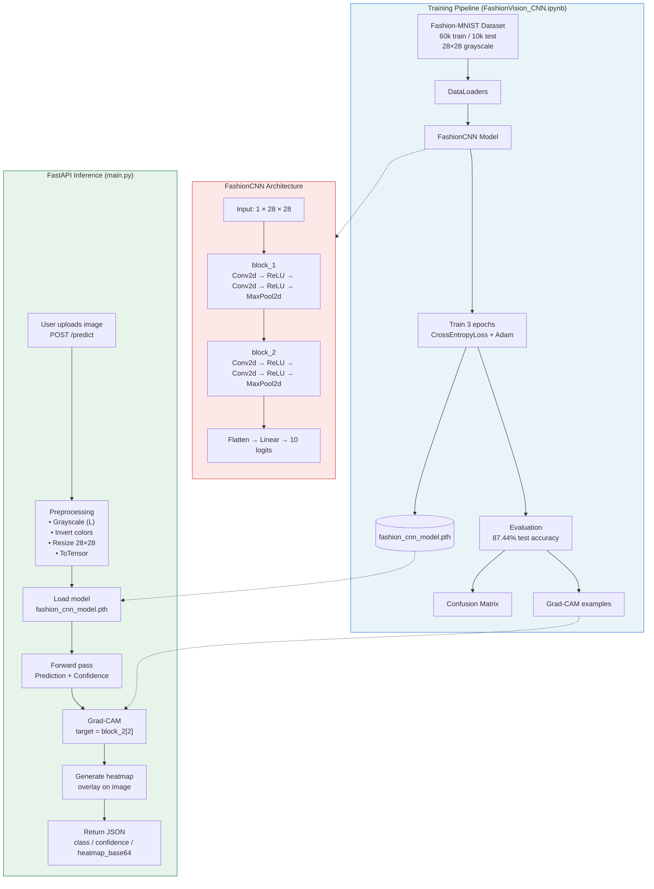
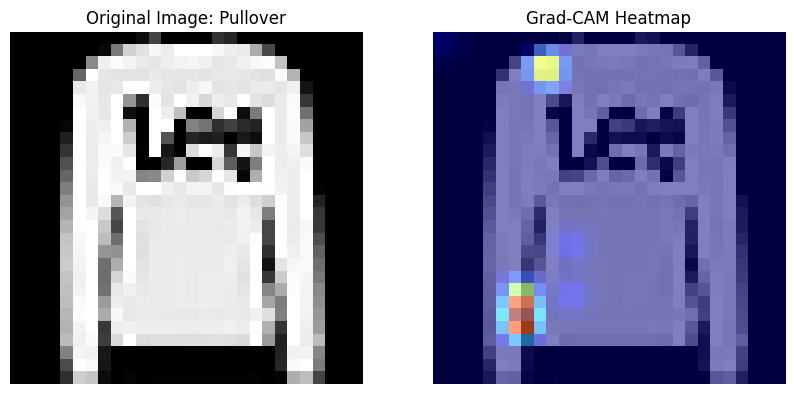
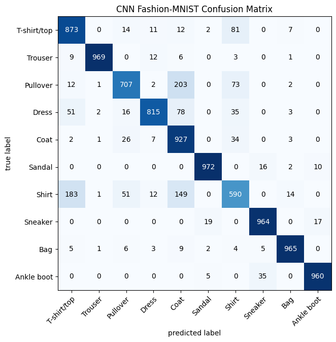
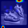

# FashionVision: CNN Classification & Explainability

[](https://colab.research.google.com/drive/1yS-nlTJ_AVkpe9walgLDhRH-_uUOaKAR?usp=sharing)
[](https://www.python.org/)
[](https://pytorch.org/)
[](https://fastapi.tiangolo.com/)

> A complete Computer Vision pipeline that classifies clothing items, explains *why* the model made its decision using Grad-CAM, and serves real-world images through a FastAPI backend.

---

## Table of Contents

- [Project Overview](#project-overview)
- [Architecture Diagram](#architecture-diagram)
- [Model Architecture (TinyVGG)](#model-architecture-tinyvgg)
- [Results & Performance](#results--performance)
- [Problems Solved](#problems-solved)
- [Real-Life Testing & Usage](#real-life-testing--usage)
- [How to Run Locally](#how-to-run-locally)
- [API Reference](#api-reference)
- [Project Structure](#project-structure)
- [Future Improvements](#future-improvements)

---

## Project Overview

FashionVision is an end-to-end fashion image classification system built with **PyTorch**.  
Unlike typical accuracy-only projects, this one focuses on three goals:

1. **Accurate classification** of 10 clothing categories (Fashion-MNIST)
2. **Explainability** — visualise exactly which pixels the model is looking at (Grad-CAM)
3. **Real-world usability** — a FastAPI service that accepts any photo, handles distribution shift, and returns both the prediction and a heatmap

| Feature                    | Status |
|---------------------------|--------|
| Custom CNN (TinyVGG)      | ✅     |
| 87.44% test accuracy      | ✅     |
| Grad-CAM explainability   | ✅     |
| FastAPI inference server  | ✅     |
| Color inversion fix       | ✅     |
| Ready for real photos     | ✅     |

---

## Architecture Diagram



---

## Model Architecture (TinyVGG)

A lightweight Convolutional Neural Network designed specifically for 28×28 grayscale clothing images.

```text
Input: 1 × 28 × 28
│
├── block_1
│   ├── Conv2d(1 → 10, kernel=3, padding=1) + ReLU
│   ├── Conv2d(10 → 10, kernel=3, padding=1) + ReLU
│   └── MaxPool2d(2×2)          → 10 × 14 × 14
│
├── block_2
│   ├── Conv2d(10 → 10, kernel=3, padding=1) + ReLU
│   ├── Conv2d(10 → 10, kernel=3, padding=1) + ReLU
│   └── MaxPool2d(2×2)          → 10 × 7 × 7
│
└── classifier
    ├── Flatten()
    └── Linear(10×7×7 → 10)     → 10 class logits
```

**Why this design?**
- Convolutions preserve spatial structure (sleeves, collars, shoe shapes)
- Max-pooling reduces computation and forces the network to focus on the most important features
- Extremely small model (~35 KB weights) → fast inference even on CPU

**Classes predicted**

| Index | Class        |
|-------|--------------|
| 0     | T-shirt/top  |
| 1     | Trouser      |
| 2     | Pullover     |
| 3     | Dress        |
| 4     | Coat         |
| 5     | Sandal       |
| 6     | Shirt        |
| 7     | Sneaker      |
| 8     | Bag          |
| 9     | Ankle boot   |

---

## Results & Performance

**Test Accuracy: 87.44%** after only 3 epochs.

### What the model got right (Grad-CAM)

The model correctly focuses on structural parts of the clothing (shoulders, collar, shoe silhouette) instead of being distracted by logos or textures.



### Where it struggled (Confusion Matrix)

Upper-body items that share similar silhouettes (Coat ↔ Shirt ↔ Pullover) are the main source of confusion. Footwear classes are classified very reliably.



---

## Problems Solved

### 1. Distribution Shift (Real-world images vs Training data)

**Problem**  
When a real photo of a shoe (downloaded from Google) was sent to the model, it confidently predicted **“Bag”**.  

**Root cause (discovered with Grad-CAM)**  
Fashion-MNIST training images have a **black background**. Real photos usually have a **white or light background**. The model was reacting strongly to the bright background instead of the shoe itself.



**Solution**  
In the FastAPI preprocessing pipeline the image is automatically inverted:

```python
image = ImageOps.invert(image)   # white background → black background
```

After this single fix the same shoe image is correctly classified as **“Sneaker”** or **“Ankle boot”**.

### 2. Making the model usable in production

Instead of keeping the model inside a Jupyter notebook, it is now served as a clean REST API that:
- Accepts any image format
- Handles resizing + color inversion automatically
- Returns both the class name and a Base64 Grad-CAM heatmap that a frontend can display immediately

---

## Real-Life Testing & Usage

You can test the system with everyday photos right now.

### Step-by-step real-life test

1. **Start the server** (see [How to Run Locally](#how-to-run-locally))
2. Take or download a photo of any clothing item / shoe / bag
3. Send it to the API:

```bash
curl -X POST "http://127.0.0.1:8000/predict" \
  -H "accept: application/json" \
  -H "Content-Type: multipart/form-data" \
  -F "file=@your_photo.jpg"
```

4. Example response:

```json
{
  "class": "Sneaker",
  "confidence": 94.87,
  "heatmap_base64": "data:image/png;base64,iVBORw0KGgoAAAANSUhEUgAA..."
}
```

5. Copy the `heatmap_base64` value into any browser address bar (or a simple HTML page) to see the Grad-CAM overlay.

### Tips for best results

| Tip | Reason |
|-----|--------|
| Prefer simple backgrounds | Model was trained on plain backgrounds |
| Center the clothing item  | Helps the network focus |
| Avoid heavy occlusion     | Model is only 28×28 resolution |
| Use the color-inversion fix (already built-in) | Critical for real photos |

---

## How to Run Locally

### 1. Clone the repository

```bash
git clone https://github.com/the-matrixneo/fashion-vision.git
cd fashion-vision
```

### 2. Install dependencies

```bash
pip install fastapi uvicorn torch torchvision pillow grad-cam numpy matplotlib python-multipart
```

### 3. Start the FastAPI server

```bash
uvicorn main:app --reload
```

The API will be available at: **http://127.0.0.1:8000**

Interactive docs (Swagger UI): **http://127.0.0.1:8000/docs**

### 4. (Optional) Explore the training notebook

Open `FashionVision_CNN.ipynb` in Google Colab or locally to retrain or experiment.

---

## API Reference

### `POST /predict`

| Parameter | Type   | Description              |
|-----------|--------|--------------------------|
| `file`    | file   | Image file (jpg, png…)   |

**Response**

```json
{
  "class": "string",
  "confidence": 0.0,
  "heatmap_base64": "data:image/png;base64,..."
}
```

---

## Project Structure

```text
fashion-vision/
├── FashionVision_CNN.ipynb   # Full training + evaluation + Grad-CAM experiments
├── main.py                   # FastAPI application + model definition
├── fashion_cnn_model.pth     # Trained weights (~35 KB)
├── assets/
│   ├── confusion_matrix.png
│   ├── grad_cam.png
│   └── pullover_success.png
└── Readme.md                 # This file
```

---

## Future Improvements

- [ ] Add data augmentation / deeper architecture to improve Coat/Shirt/Pullover separation
- [ ] Deploy the API (Railway / Render / Hugging Face Spaces)
- [ ] Simple React or Streamlit frontend that shows the heatmap live
- [ ] Support multi-item detection (currently single-item classification)
- [ ] Quantize the model for even faster mobile inference

---

**Built with ❤️ using PyTorch + FastAPI + Grad-CAM**
